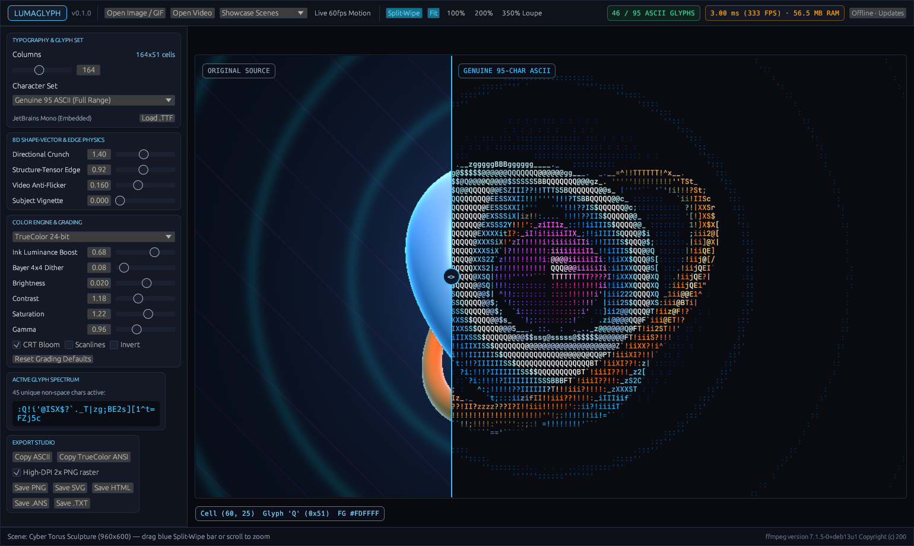
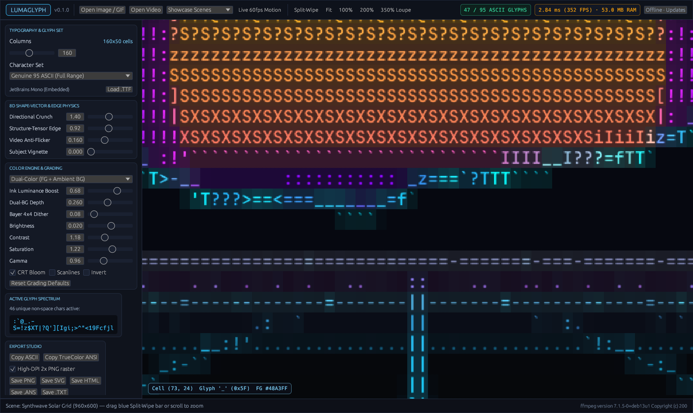

# LumaGlyph

[](https://github.com/goldggs/lumaglyph/actions/workflows/ci.yml)
[](https://github.com/goldggs/lumaglyph/releases)
[](LICENSE)

**Blazing-fast, ultra-low-memory genuine 95-character color ASCII art & video studio in pure Rust.**

Unlike basic 10-character brightness ramps (`@%#*+=-:. `), **LumaGlyph** treats every printable 7-bit ASCII glyph (`0x20..=0x7E`) as 2D geometry. Each font is dynamically calibrated into 32-byte-aligned **8D shape + structure-tensor orientation vectors**, locking `/ \ | _ ( ) [ ] < > ^ ~ , ' ; ! ? $ & % W M # @` directly onto curves, diagonals, silhouettes, and tonal gradients at hundreds of frames per second.





---

## Highlights

- **Genuine 95-Character Shape-Vector Matching:** 6 staggered spatial sub-cells + 2D structure-tensor orientation (`Jxx - Jyy`, `2·Jxy`) with external-neighbor directional contrast crunching.
- **Rich Color Physics:**
  - **24-bit TrueColor** with **Ink-Coverage Luminance Compensation** (thin glyphs like `/` or `;` boost chroma/luma inversely to ink density so edges stay vivid).
  - **Dual-Color (FG + Ambient BG)** demoscene/BBS mode, **CRT Amber & P1 Green Phosphor**, **Cyberpunk Neon**, **ANSI-16**, **xterm-256**, and **Monochrome Ivory** + ordered **Bayer 4×4 dithering**.
- **Smooth Video-to-ASCII with Flat RAM (~8 MB):**
  - Streams frames over bounded `ffmpeg` `rgb24` pipes so 4K or hour-long videos use flat memory without buffering frames in RAM, while preserving original audio tracks (`AAC`/`MP4`).
  - **Temporal Anti-Flicker (Hysteresis)** eliminates compression-noise character boiling between frames.
- **Native GPU Studio + Headless CLI in One Single Binary:**
  - Lightweight native OpenGL (`eframe`/`glow`) studio with interactive **Split-Wipe comparison**, **350% Magnifier Loupe**, **Cell Inspector HUD**, **Live 60fps Motion Stream**, and no Chromium/WebView bloat.
- **100% Native Offline by Default:**
  - Zero telemetry and zero network calls on startup. Only connects to `api.github.com/repos/goldggs/lumaglyph/releases/latest` when you click **Check GitHub Releases Now** or explicitly opt in.
- **Reproducible, Path-Sanitized GitHub Actions Releases:**
  - Built exclusively inside GitHub Actions runners across **Linux (`x86_64`)**, **macOS (`arm64` & `x86_64`)**, and **Windows (`x86_64`)** with `--remap-path-prefix`, `/DEBUG:NONE` (on MSVC), stripped symbols, and an automated CI binary byte-audit verifying zero leaked build paths.

---

## Quick Start

Download prebuilt binaries for **Linux**, **macOS**, and **Windows** from [**GitHub Releases**](https://github.com/goldggs/lumaglyph/releases).

### Launch Native GPU Studio
```bash
lumaglyph
# Or open an image / video directly in the studio:
lumaglyph photo.png
lumaglyph clip.mp4
```

### Headless CLI — Image to Genuine ASCII
```bash
# High-DPI PNG export (TrueColor or Dual-Color + CRT Phosphor Bloom)
lumaglyph image input.jpg -o art.png --cols 170 --color dual --bloom

# Scalable SVG, standalone dark HTML, 24-bit terminal ANSI (.ans), or plain .txt
lumaglyph image input.jpg -o art.svg --cols 160
lumaglyph image input.jpg -o art.ans --cols 140
cat art.ans

# Print TrueColor ASCII straight to your terminal
lumaglyph image sample:cyber --cols 120
```

### Headless CLI — Flat-RAM Video to ASCII Video
> Requires `ffmpeg` / `ffprobe` on `PATH` (or placed next to the `lumaglyph` executable).

```bash
# Stream-transcode MP4 -> H.264 ASCII MP4 (audio preserved, temporal anti-flicker enabled)
lumaglyph video input.mp4 -o ascii_video.mp4 --cols 160 --stability 0.18 --bloom

# Export looping GIF or playable terminal animation (.ans)
lumaglyph video input.mp4 -o loop.gif --cols 120
lumaglyph video input.mp4 -o stream.ans --cols 120
```

### Benchmark Throughput & Memory Footprint
```bash
lumaglyph bench --cols 180 --iters 200
```

---

## Building from Source

```bash
cargo build --release --locked
```

On Debian/Ubuntu Linux, install windowing/GL headers before building the GUI:
```bash
sudo apt-get install -y \
  libxcb-render0-dev libxcb-shape0-dev libxcb-xfixes0-dev \
  libxkbcommon-dev libxkbcommon-x11-dev libwayland-dev \
  libxcursor-dev libxi-dev libxinerama-dev libxrandr-dev \
  libgl1-mesa-dev libegl1-mesa-dev
```

---

## License

Released under the [MIT License](LICENSE). Includes embedded [JetBrains Mono](assets/fonts/OFL-JetBrainsMono.txt) under the SIL Open Font License 1.1.
