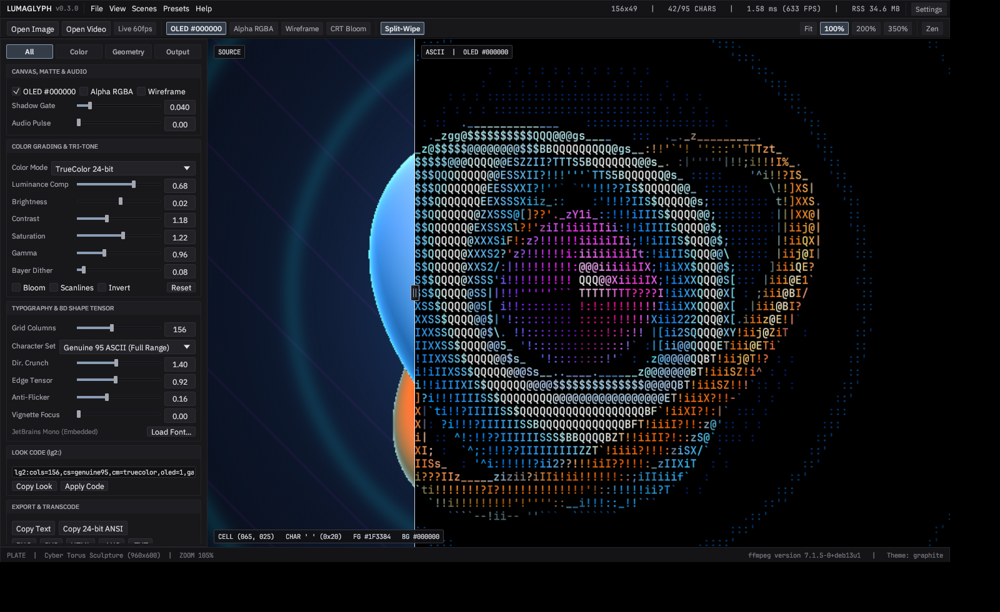
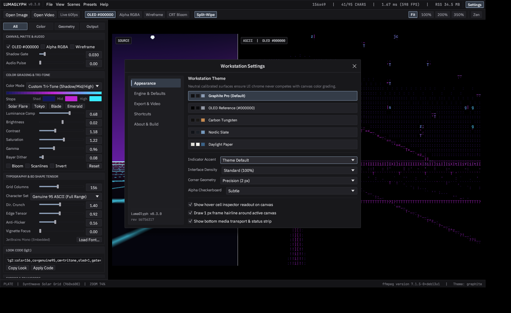
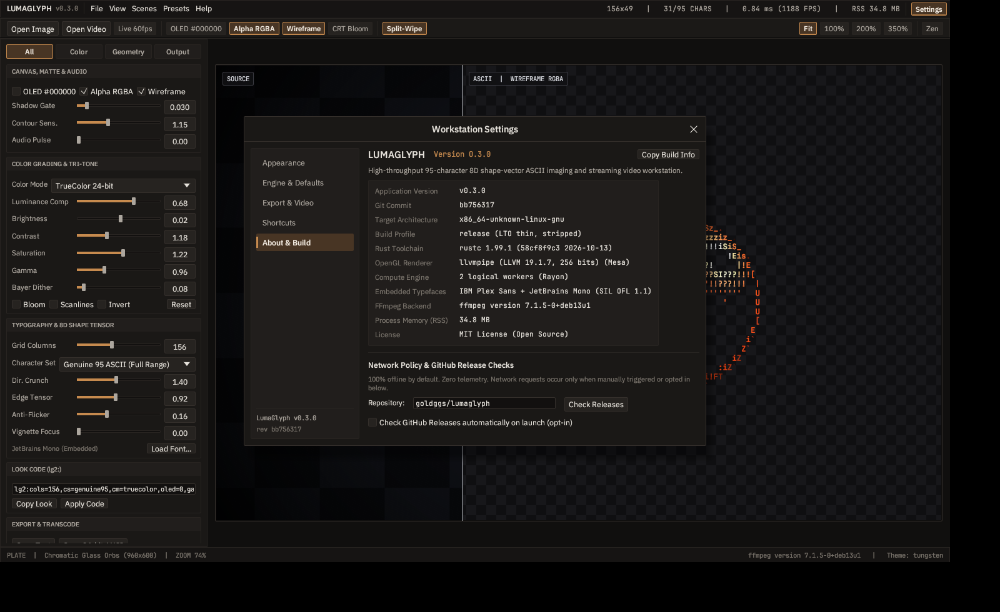
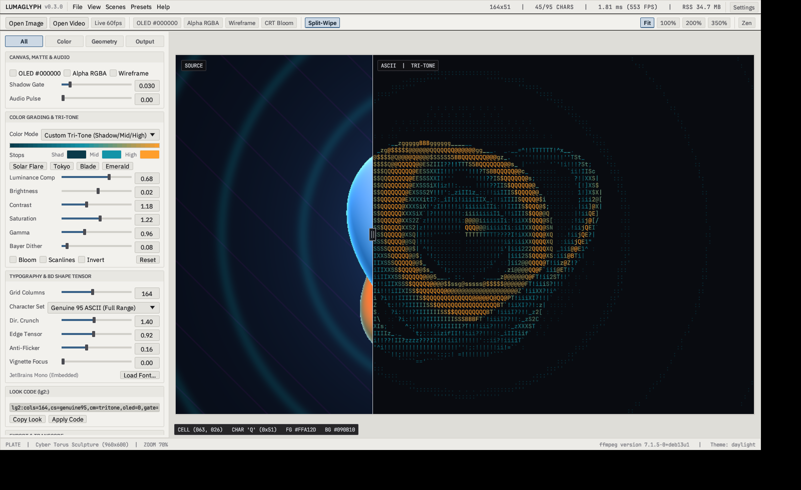

# LumaGlyph

[](https://github.com/goldggs/lumaglyph/actions/workflows/ci.yml)
[](https://github.com/goldggs/lumaglyph/releases)
[](LICENSE)

**High-throughput, ultra-low-memory 95-character color ASCII imaging and streaming video workstation in native Rust.**

Unlike basic 10-character brightness ramps (`@%#*+=-:. `), **LumaGlyph** treats every printable 7-bit ASCII glyph (`0x20..=0x7E`) as 2D geometry. Each font is dynamically calibrated into 32-byte-aligned **8D shape + structure-tensor orientation vectors**, locking `/ \ | _ ( ) [ ] < > ^ ~ , ' ; ! ? $ & % W M # @` directly onto curves, diagonals, silhouettes, and tonal gradients at **500+ FPS** (`< 2 ms/frame`) and **`~7-9 MB` CLI RSS**.



---

## New in `v0.3.0` — Pro Grading Suite Workstation

- **Calibrated Pro Grading Suite Chrome:**
  - Redesigned from the ground up around professional color-grading workstations (neutral matte `#141416` / `#1C1C1F` surfaces, tight `2px` precision geometry, `1px` low-contrast hairline rules, top menu + command strip, segmented `All | Color | Geometry | Output` inspector, and custom two-column scrub faders with double-click-to-reset).
  - Zero emojis anywhere in the interface or binary (`eframe` stock fonts and `NotoEmoji` stripped at compile time) and zero glowing neon UI badges so canvas color grading never competes with application chrome.
- **Embedded Studio Typography (`IBM Plex Sans` + `JetBrains Mono`):**
  - Ships self-contained with **IBM Plex Sans** (`Regular` + `Medium`) for crisp technical UI labels and **JetBrains Mono** for aligned tabular numeric readouts, hex codes, cell coordinates, `lg2:` Look Codes, and the 95-glyph ASCII engine.
- **Multi-Tab Workstation Settings (`Ctrl+,`):**
  - **Appearance:** 5 calibrated workstation themes (**Graphite Pro**, **OLED Reference `#000000`**, **Carbon Tungsten**, **Nordic Slate**, and **Daylight Paper**), 6 indicator accent overrides, UI density scaling (`92%` / `100%` / `112%`), corner geometry (`0px` / `2px` / `4px`), alpha checkerboard contrast, and viewport frame/HUD controls.
  - **Engine & Defaults:** Persistent startup grid columns, character preset, color mode, OLED matte default, and configurable Rayon worker pool cap.
  - **Export & Video:** PNG raster supersampling (`1x` / `2x HiDPI` / `3x Print`), H.264 MP4 `-crf` quality control (`10..=30`), and custom `ffmpeg` / `ffprobe` binary directory configuration with live detection.
  - **Shortcuts:** Complete keyboard and mouse reference (`Ctrl+,` Settings, `Tab` Zen viewport, `Space` Play/Pause, `W` Split-Wipe, `O` OLED Black, `T` Alpha RGBA, `N` Wireframe, `[ / ]` Columns, `0-3` Zoom).
  - **About & Build:** Live diagnostic table displaying exact application version, Git commit revision, target architecture triple, build profile, `rustc` toolchain, active OpenGL GPU renderer, Rayon worker count, `ffmpeg` backend status, live RSS memory footprint, one-click **Copy Build Info**, and opt-in GitHub release checks.
- **New `lumaglyph build-info` CLI Subcommand + Studio Flags:**
  - Inspect build/toolchain/runtime diagnostics from any terminal via `lumaglyph build-info` (alias `lumaglyph info`), or boot directly into any theme or settings tab via `lumaglyph studio --theme tungsten --settings about`.







---

## Core Engine Capabilities

- **Genuine 95-Character Shape-Vector Matching:** 6 staggered spatial sub-cells + 2D structure-tensor orientation (`Jxx - Jyy`, `2*Jxy`) with external-neighbor directional contrast crunching.
- **True OLED `#000000` Pitch-Black Mode + Shadow Noise Gate:** `--oled-black` + `--black-gate <0.00..0.35>` clamps dark sensor/compression grain cleanly to `' '` + `#000000`.
- **Transparent Alpha Exports (`RGBA [0,0,0,0]`) + Neon Wireframe Mode:** `--transparent` and `--wireframe` render alpha-cutout overlays across **PNG**, **SVG**, **HTML**, **GIF**, **VP9 Alpha `.webm` (`yuva420p`)**, and **RGBA `.mov`**.
- **Audio-Reactive Streaming Video (`--audio-reactive`):** Bounded `ffmpeg` pipes process 4K or hour-long videos in flat `~7-9 MB` RAM while preserving audio tracks and modulating edge lock and luminance in sync with transient beats.
- **9 Color Modes & Custom Tri-Tone Ramps:** **TrueColor 24-bit** (with ink-coverage luminance compensation), **Dual-Color**, **Custom Tri-Tone** (`Shadow -> Midtone -> Highlight`), **CRT Amber & P1 Green**, **Cyberpunk Neon**, **ANSI-16**, **xterm-256**, and **Monochrome Ivory** + shareable `lg2:` Look Codes.
- **100% Offline by Default & Path-Sanitized Releases:** Zero telemetry and zero startup network sockets. Cross-platform binaries for **Linux (`x86_64`)**, **macOS (`arm64` & `x86_64`)**, and **Windows (`x86_64`)** are built in GitHub Actions with `--remap-path-prefix`, `/DEBUG:NONE`, symbol stripping, and an automated CI binary path-leak audit.

---

## Quick Start

Download prebuilt binaries for **Linux**, **macOS**, and **Windows** from [**GitHub Releases**](https://github.com/goldggs/lumaglyph/releases).

### Launch Native GPU Workstation
```bash
lumaglyph
# Open media directly or select a workstation theme:
lumaglyph photo.png
lumaglyph studio clip.mp4 --theme tungsten
lumaglyph studio --settings about
```

### Inspect Version & Build Diagnostics
```bash
lumaglyph build-info
```

### Headless CLI — Image to Genuine ASCII
```bash
# True OLED #000000 pitch-black PNG with Shadow Noise Gate + CRT Bloom
lumaglyph image input.jpg -o oled_art.png --cols 172 --oled-black --black-gate 0.06 --bloom

# Transparent RGBA Neon Wireframe overlay PNG + Custom Tri-Tone ramp
lumaglyph image input.jpg -o overlay.png --cols 168 --transparent --wireframe --tritone tokyo

# Apply a shareable lg2: Look Code directly
lumaglyph image input.jpg -o styled.png --look "lg2:cols=180,cs=genuine95,cm=tritone,oled=1,gate=0.050,bl=1,tri=2A0A52-E11D48-FDE047"
```

### Headless CLI — Flat-RAM Video to ASCII Video
> Requires `ffmpeg` / `ffprobe` on `PATH` (or configured in `Settings -> Export & Video`).

```bash
# Audio-Reactive + True OLED #000000 H.264 MP4 (audio preserved, flat ~8 MB RAM)
lumaglyph video input.mp4 -o reactive_oled.mp4 --cols 164 --oled-black --audio-reactive 1.30 --tritone solar --bloom

# Transparent Alpha VP9 .webm or QuickTime RGBA .mov wireframe overlay for Premiere / Resolve / OBS
lumaglyph video input.mp4 -o alpha_overlay.webm --cols 152 --transparent --wireframe --tritone tokyo
lumaglyph video input.mp4 -o alpha_overlay.mov  --cols 152 --transparent --wireframe
```

### Benchmark Throughput & Memory Footprint
```bash
lumaglyph bench --cols 180 --iters 200
```

---

## Building from Source

```bash
cargo build --release --locked
```

On Debian/Ubuntu Linux, install windowing and OpenGL headers before building:
```bash
sudo apt-get install -y \
  libxcb-render0-dev libxcb-shape0-dev libxcb-xfixes0-dev \
  libxkbcommon-dev libxkbcommon-x11-dev libwayland-dev \
  libxcursor-dev libxi-dev libxinerama-dev libxrandr-dev \
  libgl1-mesa-dev libegl1-mesa-dev
```

---

## License

Released under the [MIT License](LICENSE). Includes embedded [IBM Plex Sans](assets/fonts/OFL-IBMPlexSans.txt) and [JetBrains Mono](assets/fonts/OFL-JetBrainsMono.txt) under the SIL Open Font License 1.1.
