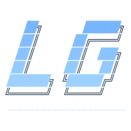
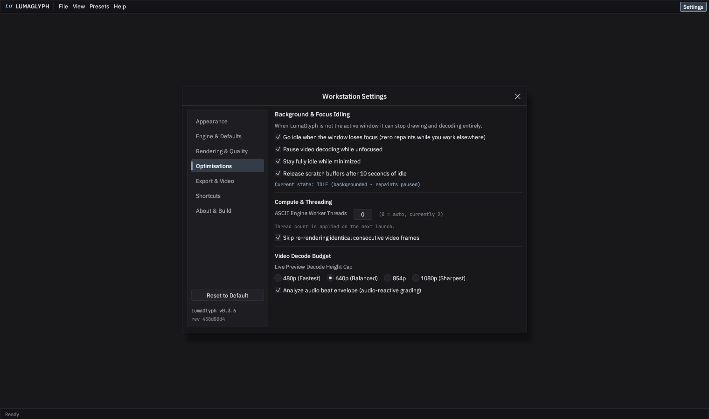
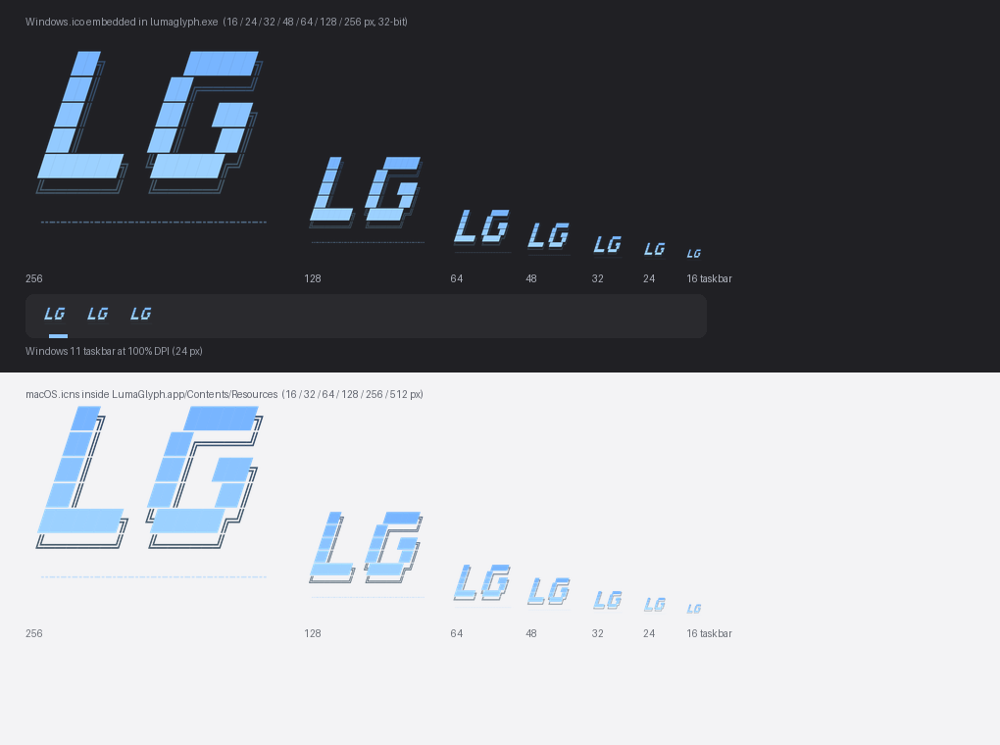
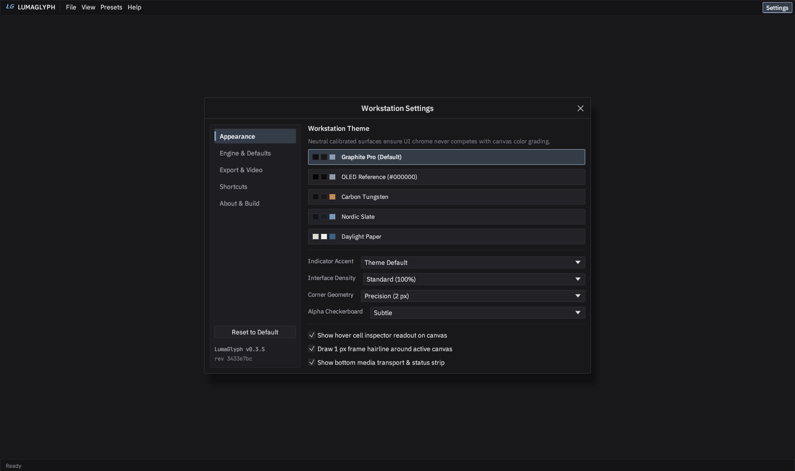
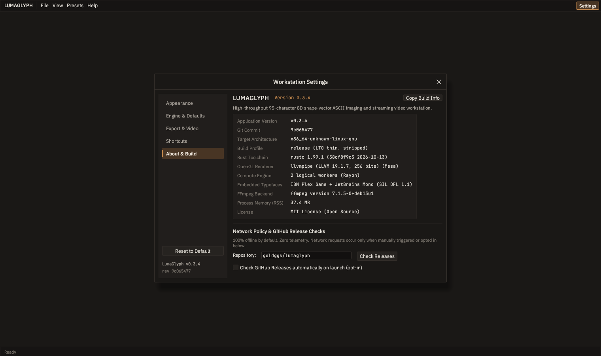

<p align="center">
  
</p>

<h1 align="center">LumaGlyph</h1>

<p align="center">
  Turn any image or video into genuine, colorful ASCII art.<br />
  A single app. No installer, no account, no internet required.
</p>

<p align="center">
  <a href="https://github.com/goldggs/lumaglyph/releases/latest"><b>Download LumaGlyph</b></a>
  &nbsp;|&nbsp;
  <a href="docs/INSTALL.md">How to install</a>
  &nbsp;|&nbsp;
  <a href="docs/QUICKSTART.md">Quick start</a>
  &nbsp;|&nbsp;
  <a href="docs/USER-GUIDE.md">User guide</a>
</p>

---

## Download and run it (no coding needed)

**Step 1.** Open the releases page: **<https://github.com/goldggs/lumaglyph/releases/latest>**

**Step 2.** Scroll down to the heading called **Assets** on that page, and click the file for your
computer:

| Your computer | Click this file |
| :--- | :--- |
| **Windows 10 / 11** | [`lumaglyph-windows-x86_64.zip`](https://github.com/goldggs/lumaglyph/releases/latest/download/lumaglyph-windows-x86_64.zip) |
| **Mac, Apple Silicon** (M1 / M2 / M3 / M4) | [`LumaGlyph-macos-arm64-app.zip`](https://github.com/goldggs/lumaglyph/releases/latest/download/LumaGlyph-macos-arm64-app.zip) |
| **Mac, Intel** | [`LumaGlyph-macos-x86_64-app.zip`](https://github.com/goldggs/lumaglyph/releases/latest/download/LumaGlyph-macos-x86_64-app.zip) |
| **Linux** | [`lumaglyph-linux-x86_64.tar.gz`](https://github.com/goldggs/lumaglyph/releases/latest/download/lumaglyph-linux-x86_64.tar.gz) |

**Step 3.** Unzip it and open the app:

- **Windows:** extract the zip, then double-click `lumaglyph.exe`. If Windows shows "Windows
  protected your PC", click **More info > Run anyway** - that is normal for any app outside the
  Microsoft Store.
- **macOS:** double-click the zip to get `LumaGlyph.app`, drag it to Applications, then
  **right-click > Open** the first time.
- **Linux:** extract, then `chmod +x lumaglyph && ./lumaglyph`.

That is the whole installation. The app opens into a calm empty window - press `Ctrl + O`
(`Cmd + O` on macOS) or drag an image onto it.

> **New to GitHub?** You are not alone, and this page is written for you. The full walkthrough with
> screenshots of where to click is in **[docs/INSTALL.md](docs/INSTALL.md)**. You never need a
> GitHub account, a terminal, or any developer tools to use LumaGlyph.


---

## Documentation

| Guide | Read it when you want to... |
| :--- | :--- |
| **[1. Download & Install](docs/INSTALL.md)** | Know exactly which file to pick and how to open it, per OS. |
| **[2. Quick Start](docs/QUICKSTART.md)** | Open your first image or video, tweak it, and save the result. |
| **[3. User Guide](docs/USER-GUIDE.md)** | Understand every panel, slider, settings tab, and shortcut. |
| **[4. Troubleshooting & FAQ](docs/TROUBLESHOOTING.md)** | Fix "it will not open", stutter, no audio reaction, and more. |
| **[5. Building From Source](docs/DEVELOPING.md)** | Compile it, run the tests, or work on the code. |

The same guides are built into the app: press **F1** anywhere, or use the **Help** menu.

---

## New in `v0.3.6` - Optimisation & Rendering Tabs, In-App Documentation, On-Video Transport

- **On-Video Playback Controls & Timeline:**
  - Play/pause now sits **directly on the video**, not in a separate toolbar, alongside jump-back and
    jump-forward-5-seconds buttons and a draggable timeline scrub bar showing `current / total`
    timecode.
  - Scrubbing re-seeks the decoder to the exact timestamp, so it is instant even in hour-long files,
    and playback continues from wherever you release the handle.
  - **Export Frame** menu on the same bar: save the **ASCII frame** as you see it, save the
    **original full-resolution source frame** as PNG, or copy the frame as ANSI text.
- **`Settings -> Rendering & Quality` Tab:**
  - Frame-rate cap (Uncapped / 15 / 24 / 30 / 60 / 144 FPS), VSync, 2x/4x/8x MSAA, texture sampling
    policy (Auto / Nearest / Bilinear), 2x supersampled canvas raster, smoothed zoom, and an optional
    live measured-FPS readout.
- **`Settings -> Optimisations` Tab:**
  - **Idle when unfocused** (zero repaints while you work in another window), **pause video decode
    while unfocused**, **stay idle while minimized**, and **release scratch buffers after 10 seconds
    of idle**.
  - Worker-thread control for the ASCII engine, redundant-frame skipping for static shots, a live
    preview decode-height cap (480p -> 1080p), and an optional audio-envelope analysis switch.
- **Documentation Written For Non-Developers:**
  - New `docs/` set: **Install**, **Quick Start**, **User Guide**, **Troubleshooting & FAQ**, and
    **Developing**, all plain-language.
  - The app links to them everywhere: **Help** menu (Getting Started, How to Download & Install, User
    Guide, Troubleshooting, Latest Downloads, Repository), a **Documentation** row on the empty
    startup window, an `F1` shortcut, and a **Documentation & Support** block in
    `Settings -> About & Build`.




---

## `v0.3.5` - Native Cross-Platform Brand Identity & Multi-OS App Packaging

- **Native Application Icons Across Windows, macOS, and Linux:**
  - **Windows (`.ico` compiled into `lumaglyph.exe`):** Multi-resolution `lumaglyph.ico`
    (`16, 24, 32, 48, 64, 128, 256` px 32-bit RGBA) and `VERSIONINFO` metadata are embedded directly
    into `lumaglyph.exe`'s PE `.rsrc` resource section via `build.rs` (verified automatically in CI).
  - **macOS (`.icns` + `LumaGlyph.app` bundle):** Ships native Apple Icon Image `lumaglyph.icns`
    (`16` up to `1024` px Retina) inside ready-to-launch `LumaGlyph-macos-{arm64,x86_64}-app.zip`
    bundles alongside standalone CLI tarballs.
  - **Linux (`.png` + `.desktop`):** Ships `lumaglyph.desktop` + `512x512` `lumaglyph.png`, while
    `ViewportBuilder::with_icon` sets the live X11/Wayland/Windows/macOS window, taskbar, and Dock
    icon at runtime from embedded `256x256` RGBA bytes.



---

## `v0.3.4` - Fresh Empty Workstation, Normal Reset & Automatic Update-and-Relaunch

- **Fresh VS Code-Style Empty Startup (Zero Samples Anywhere):** launching opens a calm, uncluttered
  empty window - slim menu strip, recessed keybinding hints, and a quiet status bar with no side
  panels until media is opened (or `Ctrl+B` toggles the Inspector).
- **One-Click Reset to Normal Default (`Ctrl+Shift+R`):** balanced, unboosted default parameters
  (`contrast = 1.0`, `saturation = 1.0`, `gamma = 1.0`, `brightness = 0.0`) render clean, faithful
  ASCII art out of the box, and can be restored from anywhere.
- **Clean Workstation Chrome:** Split-Wipe comparison curtain removed, unsolicited theme/status
  footer labels removed.
- **In-Place Release Rebuild / Install & Automatic Relaunch:** **Update & Relaunch** verifies the
  latest release, rebuilds from the verified tag inside a local Cargo checkout (with safe Windows
  `.old` swap), or atomically installs the 8-layer SHA-256-verified release binary, then relaunches.

---

## `v0.3.1` - Single-Window Windows GUI & 8-Layer Verified Updater

- **Standalone Single-App Windows GUI (`IMAGE_SUBSYSTEM_WINDOWS_GUI`):** Windows `lumaglyph.exe` is
  compiled under `windows_subsystem = "windows"` (`PE Optional Header Subsystem == 2`, verified in CI
  and release builds) so launching it opens **only** the native GPU workstation with **zero attached
  console/terminal window**. Headless CLI subcommands attach to an existing shell via
  `AttachConsole(ATTACH_PARENT_PROCESS)` and never call `AllocConsole`; background `ffmpeg` /
  `ffprobe` / build workers always spawn with `CREATE_NO_WINDOW`.
- **8-Layer Cryptographically Verified Remote Release Checker & Installer** (opt-in only):
  1. **Canonical Repository Pinning** - locked to `goldggs/lumaglyph`.
  2. **Strict Origin & URL Parser** - HTTPS-only, no credentials, no fragments, no dot-segment or
     percent-encoded traversal, pinned to official GitHub API/Release/CDN hosts.
  3. **Manual Redirect Hop Inspection** - every `301/302/303/307/308` hop validated before
     following (`<= 3` hops), blocking HTTPS-to-HTTP downgrades and untrusted domains.
  4. **Release Integrity & Downgrade Guard** - rejects drafts, prereleases, malformed SemVer, and
     replay/downgrade versions.
  5. **Exact Platform Asset Binding** - only the archive compiled for the running OS + CPU.
  6. **Constant-Time SHA-256 Verification Before Decompression** against `SHA256SUMS.txt`.
  7. **Anti-Bomb & Anti-Traversal In-Memory Extraction** - blocks `TarSlip`/`ZipSlip`, symlinks,
     hardlinks, device nodes, unexpected sidecars, duplicate-entry shadowing, and decompression
     bombs.
  8. **Native Executable Header Check + Atomic In-Place Swap** - validates `ELF64 x86_64`,
     `Mach-O 64-bit arm64/x86_64`, or `PE32+ AMD64 WINDOWS_GUI`, swaps via sibling staging with
     `.old` backup and rollback, and relaunches automatically.

---

## Pro Grading Suite Workstation

- **Calibrated Pro Grading Suite Chrome:** neutral matte `#141416` / `#1C1C1F` surfaces, tight `2px`
  precision geometry, `1px` low-contrast hairline rules, collapsible `All | Color | Geometry |
  Output` inspector (`Ctrl+B`), one-click **Reset to Default** (`Ctrl+Shift+R`), and custom
  two-column scrub faders with double-click-to-reset. Zero emojis and zero glowing badges, so canvas
  color grading never competes with application chrome.
- **Embedded Studio Typography:** **IBM Plex Sans** (Regular + Medium) for UI labels and
  **JetBrains Mono** for aligned tabular numerics, hex codes, cell coordinates, `lg2:` Look Codes.
- **Seven-Tab Workstation Settings (`Ctrl+,`):** Appearance, Engine & Defaults, **Rendering &
  Quality**, **Optimisations**, Export & Video, Shortcuts, and About & Build.





---

## Core Engine Capabilities

- **Genuine 95-Character Shape-Vector Matching:** 6 staggered spatial sub-cells + 2D structure-tensor
  orientation (`Jxx - Jyy`, `2*Jxy`) with external-neighbor directional contrast crunching. Every
  printable ASCII glyph (`0x20..=0x7E`) is treated as geometry, not as a brightness ramp.
- **True OLED `#000000` Pitch-Black Mode + Shadow Noise Gate:** clamps dark sensor and compression
  grain cleanly to `' '` + `#000000`.
- **Transparent Alpha Exports (`RGBA [0,0,0,0]`) + Neon Wireframe Mode:** alpha-cutout overlays across
  **PNG**, **SVG**, **HTML**, **GIF**, **VP9 Alpha `.webm` (`yuva420p`)**, and **RGBA `.mov`**.
- **Audio-Reactive Streaming Video:** bounded `ffmpeg` pipes process 4K or hour-long videos in flat
  `~7-9 MB` RAM while preserving audio tracks and modulating edge lock and luminance in sync with
  transient beats.
- **9 Color Modes & Custom Tri-Tone Ramps:** TrueColor 24-bit, Dual-Color, Custom Tri-Tone, CRT Amber
  & P1 Green, Cyberpunk Neon, ANSI-16, xterm-256, Monochrome Ivory, plus shareable `lg2:` Look Codes.
- **100% Offline by Default & Path-Sanitized Releases:** zero telemetry and zero startup network
  sockets. Cross-platform binaries are built in GitHub Actions with `--remap-path-prefix`,
  `/DEBUG:NONE`, symbol stripping, Windows `WINDOWS_GUI` PE subsystem verification, and an automated
  binary path-leak audit.

---

## Command Line

Download prebuilt binaries from [**GitHub Releases**](https://github.com/goldggs/lumaglyph/releases).

### Launch the native GPU workstation

```bash
lumaglyph                                  # clean empty workstation
lumaglyph photo.png                        # open an image immediately
lumaglyph studio clip.mp4 --theme tungsten
lumaglyph studio --settings optimisations   # jump straight to a settings tab
```

### Build diagnostics & verified release updates

```bash
lumaglyph build-info
lumaglyph check-update
lumaglyph update            # verified in-place install + relaunch (alias of self-update)
```

### Headless CLI - image to genuine ASCII

```bash
# True OLED #000000 pitch-black PNG with Shadow Noise Gate + CRT Bloom
lumaglyph image input.jpg -o oled_art.png --cols 172 --oled-black --black-gate 0.06 --bloom

# Transparent RGBA Neon Wireframe overlay PNG + Custom Tri-Tone ramp
lumaglyph image input.jpg -o overlay.png --cols 168 --transparent --wireframe --tritone tokyo

# Apply a shareable lg2: Look Code directly
lumaglyph image input.jpg -o styled.png --look "lg2:cols=180,cs=genuine95,cm=tritone,oled=1,gate=0.050,bl=1,tri=2A0A52-E11D48-FDE047"
```

### Headless CLI - flat-RAM video to ASCII video

> Requires `ffmpeg` / `ffprobe` on `PATH` (or configured in `Settings -> Export & Video`).

```bash
# Audio-Reactive + True OLED #000000 H.264 MP4 (audio preserved, flat ~8 MB RAM)
lumaglyph video input.mp4 -o reactive_oled.mp4 --cols 164 --oled-black --audio-reactive 1.30 --tritone solar --bloom

# Transparent Alpha VP9 .webm or QuickTime RGBA .mov wireframe overlay for Premiere / Resolve / OBS
lumaglyph video input.mp4 -o alpha_overlay.webm --cols 152 --transparent --wireframe --tritone tokyo
lumaglyph video input.mp4 -o alpha_overlay.mov  --cols 152 --transparent --wireframe
```

### Benchmark and test

```bash
lumaglyph bench --cols 180 --iters 200
cargo test --release --locked
```

---

## Building from Source

```bash
cargo build --release --locked
```

Development setup, test-suite layout, release pipeline, and architecture notes live in
**[docs/DEVELOPING.md](docs/DEVELOPING.md)**.

---

## License

Released under the [MIT License](LICENSE). Includes embedded [IBM Plex Sans](assets/fonts/OFL-IBMPlexSans.txt)
and [JetBrains Mono](assets/fonts/OFL-JetBrainsMono.txt) under the SIL Open Font License 1.1.
