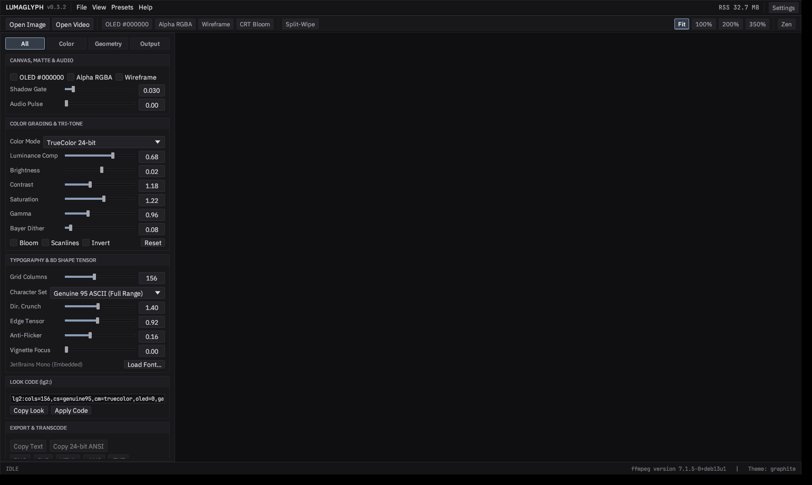

# LumaGlyph

[](https://github.com/goldggs/lumaglyph/actions/workflows/ci.yml)
[](https://github.com/goldggs/lumaglyph/releases)
[](LICENSE)

**High-throughput, ultra-low-memory 95-character color ASCII imaging and streaming video workstation in native Rust.**

Unlike basic 10-character brightness ramps (`@%#*+=-:. `), **LumaGlyph** treats every printable 7-bit ASCII glyph (`0x20..=0x7E`) as 2D geometry. Each font is dynamically calibrated into 32-byte-aligned **8D shape + structure-tensor orientation vectors**, locking `/ \ | _ ( ) [ ] < > ^ ~ , ' ; ! ? $ & % W M # @` directly onto curves, diagonals, silhouettes, and tonal gradients at **500+ FPS** (`< 2 ms/frame`) and **`~7-9 MB` CLI RSS**.



---

## New in `v0.3.2` — Clean Default Empty Workstation

- **Pure Empty Default Startup (Zero Preloaded Samples):**
  - Launching `lumaglyph` opens directly into a clean, blank calibrated workstation (`SourceKind::Empty`) with zero synthetic demo plates, zero sample menus, zero idle CPU usage, and zero pre-allocated frame textures (`~32 MB` GPU workstation RSS at idle).
  - Open media via **Open Image** (`Ctrl+O`), **Open Video** (`Ctrl+Shift+O`), OS **drag-and-drop** (images, videos, or `.ttf`/`.otf` fonts), or pass a path directly (`lumaglyph photo.png`). Press `Ctrl+W` (**File -> Close Media**) at any time to release buffers and return to the empty canvas, and toggle **Split-Wipe** (`W`) on demand when comparing against source media.

---

## `v0.3.1` Highlights — Single-Window Windows Subsystem, 8-Layer Verified Updater & 1,232 Tests

- **Standalone Single-App Windows GUI (`IMAGE_SUBSYSTEM_WINDOWS_GUI`):**
  - Windows `lumaglyph.exe` is compiled under `windows_subsystem = "windows"` (`PE Optional Header Subsystem == 2`, verified automatically in CI and Release builds) so launching `lumaglyph.exe` opens **only** the native GPU workstation with **zero attached console/terminal window**.
  - Headless CLI subcommands (`image`, `video`, `bench`, `look`, `build-info`, `check-update`) remain inside the same single binary: when invoked from an existing PowerShell / `cmd.exe` / Windows Terminal session without pipe redirection, LumaGlyph attaches cleanly via `AttachConsole(ATTACH_PARENT_PROCESS)` and never calls `AllocConsole`. Background `ffmpeg` / `ffprobe` workers always spawn with `CREATE_NO_WINDOW` (`0x0800_0000`).
- **8-Layer Cryptographically Verified Remote Release Checker & Downloader:**
  - Opt-in release checks and binary downloads (`Settings -> About & Build -> Download Verified Binary...` or `lumaglyph check-update --download`) enforce 8 independent defense layers before writing a single byte to disk:
    1. **Canonical Repository Pinning:** Locked by default to `goldggs/lumaglyph`.
    2. **Strict Origin & URL Parser:** HTTPS-only (`:443`), zero credentials, zero fragments, zero dot-segment/percent-encoded path traversal, pinned to official GitHub API/Release/CDN hosts.
    3. **Manual Redirect Hop Inspection (`redirects(0)`):** Every HTTP `301/302/303/307/308` hop is validated manually before following (`<= 3` hops), blocking HTTPS-to-HTTP downgrades and untrusted domains.
    4. **Release Integrity & Downgrade Guard:** Rejects drafts, prereleases, malformed SemVer tags, and replay/downgrade versions (`<= APP_VERSION`) before downloading.
    5. **Exact Platform Asset Binding:** Selects only the exact archive compiled for the running OS + CPU (`lumaglyph-linux-x86_64.tar.gz`, `lumaglyph-macos-arm64.tar.gz`, `lumaglyph-macos-x86_64.tar.gz`, `lumaglyph-windows-x86_64.zip`).
    6. **Mandatory Constant-Time SHA-256 Verification Before Decompression:** Fetches `SHA256SUMS.txt` from the identical release tag and verifies the raw archive bytes in constant time prior to opening `tar.gz` or `zip`.
    7. **Anti-Bomb & Anti-Traversal In-Memory Extraction:** Blocks `TarSlip`/`ZipSlip` (`..`, `/`, `\`, drive prefixes), symlinks, hardlinks, device nodes, unexpected `.dll`/`.so`/`.sh`/`.bat` sidecars, duplicate-entry shadowing, and decompression bombs.
    8. **Native CPU Executable Header + Atomic Write Verification:** Inspects magic/machine/subsystem headers (`ELF64 x86_64`, `Mach-O 64-bit arm64/x86_64`, `PE32+ AMD64 WINDOWS_GUI`) and commits via `.part` + `File::sync_all()` + atomic `fs::rename`.
- **1,232 Automated Corner-to-Corner Tests (`cargo test --release`):**
  - 7 integration and deterministic splitmix64 fuzz suites (`1,232` `#[test]` functions completing in `~3.2s`) covering URL/redirect/SHA-256/archive/PE-header fault injection against live loopback HTTP mock servers, empty-canvas & zero-sample GUI invariants, all 95 ASCII shape vectors across 18 atlas heights, all 9 color modes, `lg2:` Look Code fuzzing (`NaN`/`inf`/UTF-8 boundaries), all 90 theme x accent x corner WCAG contrast combinations, exporters, and streaming `ffmpeg` E2E transcoding.

---

## Pro Grading Suite Workstation

- **Calibrated Pro Grading Suite Chrome:**
  - Neutral matte `#141416` / `#1C1C1F` surfaces, tight `2px` precision geometry, `1px` low-contrast hairline rules, top menu + command strip, segmented `All | Color | Geometry | Output` inspector, and custom two-column scrub faders with double-click-to-reset.
  - Zero emojis anywhere in the interface or binary (`eframe` stock fonts and `NotoEmoji` stripped at compile time) and zero glowing neon UI badges so canvas color grading never competes with application chrome.
- **Embedded Studio Typography (`IBM Plex Sans` + `JetBrains Mono`):**
  - Self-contained with **IBM Plex Sans** (`Regular` + `Medium`) for UI labels and **JetBrains Mono** for aligned tabular numeric readouts, hex codes, cell coordinates, `lg2:` Look Codes, and the 95-glyph ASCII engine.
- **Multi-Tab Workstation Settings (`Ctrl+,`):**
  - **Appearance:** 5 calibrated workstation themes (**Graphite Pro**, **OLED Reference `#000000`**, **Carbon Tungsten**, **Nordic Slate**, and **Daylight Paper**), 6 indicator accent overrides, UI density scaling, corner geometry, and alpha checkerboard contrast.
  - **Engine & Defaults:** Persistent startup grid columns, character preset, color mode, OLED matte default, and configurable Rayon worker pool cap.
  - **Export & Video:** PNG raster supersampling (`1x` / `2x HiDPI` / `3x Print`), H.264 MP4 `-crf` quality control (`10..=30`), and custom `ffmpeg` / `ffprobe` binary directory configuration.
  - **Shortcuts:** Complete keyboard and mouse reference.
  - **About & Build:** Live diagnostic table, one-click **Copy Build Info**, opt-in **Check GitHub Release**, and **Download Verified Binary...** with live SHA-256 digest reporting.


---

## Core Engine Capabilities

- **Genuine 95-Character Shape-Vector Matching:** 6 staggered spatial sub-cells + 2D structure-tensor orientation (`Jxx - Jyy`, `2*Jxy`) with external-neighbor directional contrast crunching.
- **True OLED `#000000` Pitch-Black Mode + Shadow Noise Gate:** `--oled-black` + `--black-gate <0.00..0.35>` clamps dark sensor/compression grain cleanly to `' '` + `#000000`.
- **Transparent Alpha Exports (`RGBA [0,0,0,0]`) + Neon Wireframe Mode:** `--transparent` and `--wireframe` render alpha-cutout overlays across **PNG**, **SVG**, **HTML**, **GIF**, **VP9 Alpha `.webm` (`yuva420p`)**, and **RGBA `.mov`**.
- **Audio-Reactive Streaming Video (`--audio-reactive`):** Bounded `ffmpeg` pipes process 4K or hour-long videos in flat `~7-9 MB` RAM while preserving audio tracks and modulating edge lock and luminance in sync with transient beats.
- **9 Color Modes & Custom Tri-Tone Ramps:** **TrueColor 24-bit** (with ink-coverage luminance compensation), **Dual-Color**, **Custom Tri-Tone** (`Shadow -> Midtone -> Highlight`), **CRT Amber & P1 Green**, **Cyberpunk Neon**, **ANSI-16**, **xterm-256**, and **Monochrome Ivory** + shareable `lg2:` Look Codes.
- **100% Offline by Default & Path-Sanitized Releases:** Zero telemetry and zero startup network sockets. Cross-platform binaries for **Linux (`x86_64`)**, **macOS (`arm64` & `x86_64`)**, and **Windows (`x86_64`)** are built in GitHub Actions with `--remap-path-prefix`, `/DEBUG:NONE`, symbol stripping, Windows `WINDOWS_GUI` PE subsystem verification, and an automated CI binary path-leak audit.

---

## Quick Start

Download prebuilt binaries for **Linux**, **macOS**, and **Windows** from [**GitHub Releases**](https://github.com/goldggs/lumaglyph/releases).

### Launch Native GPU Workstation
```bash
# Opens clean empty default workstation:
lumaglyph

# Or open an image or video directly on launch:
lumaglyph photo.png
lumaglyph studio clip.mp4 --theme tungsten
```

### Inspect Build Diagnostics & Verified Release Updates
```bash
lumaglyph build-info
lumaglyph check-update
lumaglyph check-update --download --dest ./updates
```

### Headless CLI — Image to Genuine ASCII
```bash
# True OLED #000000 pitch-black PNG with Shadow Noise Gate + CRT Bloom
lumaglyph image input.jpg -o oled_art.png --cols 172 --oled-black --black-gate 0.06 --bloom

# Transparent RGBA Neon Wireframe overlay PNG + Custom Tri-Tone ramp
lumaglyph image input.jpg -o overlay.png --cols 168 --transparent --wireframe --tritone tokyo

# Apply a shareable lg2: Look Code directly
lumaglyph image input.jpg -o styled.png --look "lg2:cols=180,cs=genuine95,cm=tritone,oled=1,gate=0.050,bl=1,tri=2A0A52-E11D48-FDE047"
```

### Headless CLI — Flat-RAM Video to ASCII Video
> Requires `ffmpeg` / `ffprobe` on `PATH` (or configured in `Settings -> Export & Video`).

```bash
# Audio-Reactive + True OLED #000000 H.264 MP4 (audio preserved, flat ~8 MB RAM)
lumaglyph video input.mp4 -o reactive_oled.mp4 --cols 164 --oled-black --audio-reactive 1.30 --tritone solar --bloom

# Transparent Alpha VP9 .webm or QuickTime RGBA .mov wireframe overlay for Premiere / Resolve / OBS
lumaglyph video input.mp4 -o alpha_overlay.webm --cols 152 --transparent --wireframe --tritone tokyo
lumaglyph video input.mp4 -o alpha_overlay.mov  --cols 152 --transparent --wireframe
```

### Run Benchmark & Full 1,232-Test Suite
```bash
lumaglyph bench --cols 180 --iters 200
cargo test --release --locked
```

---

## Building from Source

```bash
cargo build --release --locked
```

On Debian/Ubuntu Linux, install windowing and OpenGL headers before building:
```bash
sudo apt-get install -y \
  libxcb-render0-dev libxcb-shape0-dev libxcb-xfixes0-dev \
  libxkbcommon-dev libxkbcommon-x11-dev libwayland-dev \
  libxcursor-dev libxi-dev libxinerama-dev libxrandr-dev \
  libgl1-mesa-dev libegl1-mesa-dev
```

---

## License

Released under the [MIT License](LICENSE). Includes embedded [IBM Plex Sans](assets/fonts/OFL-IBMPlexSans.txt) and [JetBrains Mono](assets/fonts/OFL-JetBrainsMono.txt) under the SIL Open Font License 1.1.
