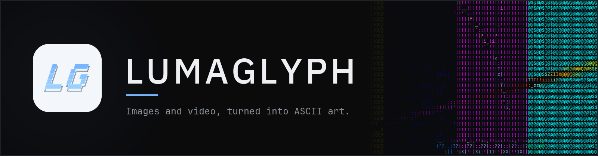
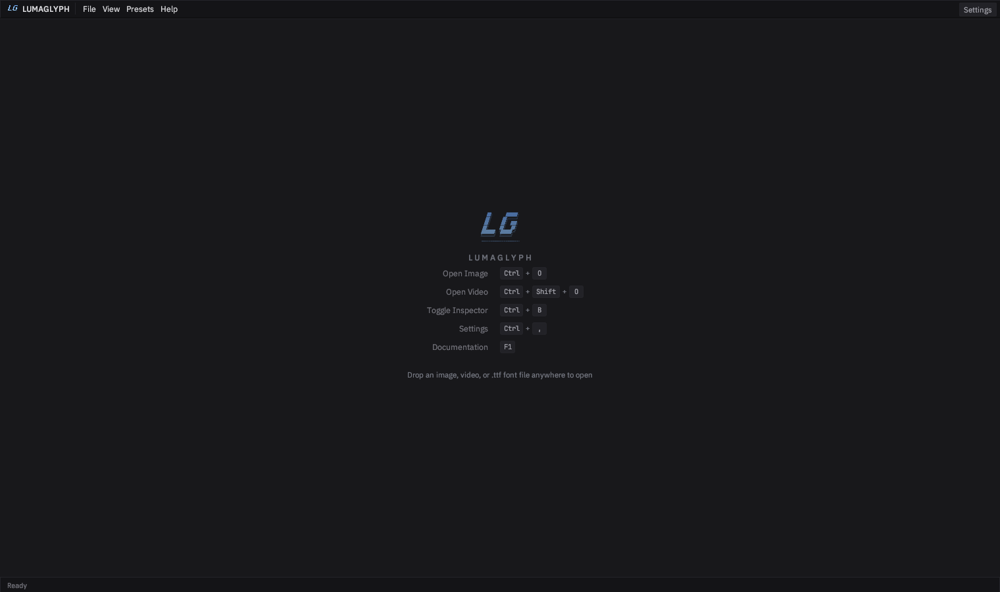
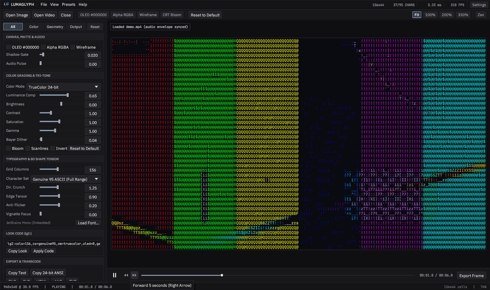

<p align="center">
  
</p>

<p align="center">
  <a href="https://github.com/goldggs/lumaglyph/releases/latest"><b>Download</b></a>
  &nbsp;|&nbsp;
  <a href="docs/INSTALL.md">Install</a>
  &nbsp;|&nbsp;
  <a href="docs/QUICKSTART.md">Quick start</a>
  &nbsp;|&nbsp;
  <a href="docs/USER-GUIDE.md">User guide</a>
  &nbsp;|&nbsp;
  <a href="docs/TROUBLESHOOTING.md">Troubleshooting</a>
</p>

---

## Download and run it

You do not need a GitHub account, a terminal, or any developer tools for this.

**1.** Open **<https://github.com/goldggs/lumaglyph/releases/latest>**

**2.** Scroll down to the **Assets** heading and click the file for your computer:

| Your computer | Click this file |
| :--- | :--- |
| **Windows 10 / 11** | [`lumaglyph-windows-x86_64.zip`](https://github.com/goldggs/lumaglyph/releases/latest/download/lumaglyph-windows-x86_64.zip) |
| **Mac, Apple Silicon** (M1 / M2 / M3 / M4) | [`LumaGlyph-macos-arm64-app.zip`](https://github.com/goldggs/lumaglyph/releases/latest/download/LumaGlyph-macos-arm64-app.zip) |
| **Mac, Intel** | [`LumaGlyph-macos-x86_64-app.zip`](https://github.com/goldggs/lumaglyph/releases/latest/download/LumaGlyph-macos-x86_64-app.zip) |
| **Linux** | [`lumaglyph-linux-x86_64.tar.gz`](https://github.com/goldggs/lumaglyph/releases/latest/download/lumaglyph-linux-x86_64.tar.gz) |

**3.** Unzip it and open the app.

- **Windows:** extract the zip, then double-click `lumaglyph.exe`. Windows may say "Windows
  protected your PC" because the app is not signed yet; click **More info > Run anyway**. This is
  being fixed (see [code signing](#code-signing)).
- **macOS:** double-click the zip to get `LumaGlyph.app`, drag it to Applications, then
  **right-click > Open** the first time.
- **Linux:** extract, then `chmod +x lumaglyph && ./lumaglyph`.

The app opens to an empty window. Press `Ctrl + O` (`Cmd + O` on macOS), or drag an image onto it.

If any of that was unclear, [docs/INSTALL.md](docs/INSTALL.md) walks through it with screenshots of
where to click.



---

## What it does

LumaGlyph reads an image or video, splits it into a grid, and picks the ASCII character whose actual
shape best matches each patch. That is different from a brightness ramp: `!` through `~` are treated
as 95 different shapes, so a diagonal edge gets a diagonal character and a curve gets a curved one.
The result stays recognisable at small sizes, which is where ladders usually fall apart.

- Images and video, including long or 4K video, decoded through ffmpeg pipes in roughly 8 MB of RAM.
- Colour, not just density: TrueColor, dual-colour, tri-tone ramps, CRT amber, P1 green, ANSI-16,
  xterm-256, monochrome.
- Transparent and wireframe exports to PNG, SVG, HTML, GIF, VP9 `.webm` with alpha, and RGBA `.mov`.
- Audio-reactive grading: loud transients push edge lock and luminance.
- Offline by default. No account, no telemetry, no socket opened at startup.
- One binary per OS. No installer, no runtime, no Electron.

Built on the shape-vector engine described in [docs/DEVELOPING.md](docs/DEVELOPING.md#the-engine).

---

## Command line

Prebuilt binaries are on [GitHub Releases](https://github.com/goldggs/lumaglyph/releases).

```bash
lumaglyph                                   # empty workstation
lumaglyph photo.png                         # open an image
lumaglyph studio clip.mp4 --theme tungsten
lumaglyph studio --settings optimisations    # jump to a settings tab
```

Headless image conversion:

```bash
# OLED black, shadow gate, bloom
lumaglyph image input.jpg -o oled_art.png --cols 172 --oled-black --black-gate 0.06 --bloom

# transparent wireframe overlay with a tri-tone ramp
lumaglyph image input.jpg -o overlay.png --cols 168 --transparent --wireframe --tritone tokyo

# replay a shared lg2: look code
lumaglyph image input.jpg -o styled.png --look "lg2:cols=180,cs=genuine95,cm=tritone,oled=1,gate=0.050,bl=1,tri=2A0A52-E11D48-FDE047"
```

Headless video conversion (needs `ffmpeg` and `ffprobe` on `PATH`, or set a folder in
`Settings > Export & Video`):

```bash
lumaglyph video input.mp4 -o reactive_oled.mp4 --cols 164 --oled-black --audio-reactive 1.30 --tritone solar --bloom
lumaglyph video input.mp4 -o alpha_overlay.webm --cols 152 --transparent --wireframe --tritone tokyo
lumaglyph video input.mp4 -o alpha_overlay.mov  --cols 152 --transparent --wireframe
```

Updates and diagnostics:

```bash
lumaglyph build-info
lumaglyph check-update
lumaglyph update            # verify, install in place, relaunch
lumaglyph bench --cols 180 --iters 200
```

---

## Documentation

| Guide | Read it when |
| :--- | :--- |
| [1. Download & Install](docs/INSTALL.md) | You need to know which file to pick and how to open it. |
| [2. Quick Start](docs/QUICKSTART.md) | You want to open a file and save your first result. |
| [3. User Guide](docs/USER-GUIDE.md) | You want a specific panel or shortcut explained. |
| [4. Troubleshooting](docs/TROUBLESHOOTING.md) | Something will not open, stutters, or looks wrong. |
| [5. Building From Source](docs/DEVELOPING.md) | You want to compile it or work on the code. |
| [6. Testing](docs/TESTING.md) | You want to know what is tested, and what is not. |
| [7. Security](docs/SECURITY.md) | You want to know what this app can and cannot do. |

The same guides are in the app: press **F1**, or use the **Help** menu.

---

## Tests

LumaGlyph is tested heavily, and the tests are part of the source tree rather than a
private CI dashboard. Full detail in **[docs/TESTING.md](docs/TESTING.md)**; the exact
per-suite counts live in **[docs/TEST-INVENTORY.md](docs/TEST-INVENTORY.md)**, which is
generated from the test binaries themselves and checked by CI so it cannot drift.

```bash
cargo test --release                 # the whole suite
cargo test --release --lib           # unit tests only, ~2 seconds
cargo test --release -- --nocapture  # shows the printed audit inventories
```

**365 test functions, 1,516 executed cases**, across fourteen suites. The count is
not self-reported: `docs/TEST-INVENTORY.md` is generated by running the test binaries,
and CI fails if the committed table disagrees with the code.

Three kinds of coverage:

| Kind | Suites | What they actually do |
| :--- | :--- | :--- |
| **Unit**, inside `src/` | colour, engine, charset, glyph atlas, export, look, updater, telemetry, video, gui geometry | Fast and precise. A failure names one function. Includes the canvas arithmetic behind zoom, fit, the transport-band split, timeline mapping and cell hit-testing. |
| **Integration**, in `tests/` | `cli_contract_matrix`, `engine_stress_and_fuzz`, `combinatorial_fuzz_matrix`, `engine_and_color_matrix`, `glyph_and_charset_matrix`, `look_export_and_cli_matrix`, `themes_prefs_and_binary_audit`, `video_and_cli_e2e`, `legal_and_community_hygiene` | Run the real binary and the real pipeline. Every output format, every colour mode, every charset, corrupt input, truncated buffers, NaN parameters, hostile filenames. |
| **Audit**, in `tests/` | `security_and_provenance_audit`, `remote_update_security`, `golden_render`, `icon_and_perf_guard` | Verify claims rather than behaviour: what the code can and cannot do, whether a render still looks the same, and whether the cost curve still has the right shape. |

A few specifics, because "we have tests" is not information:

- **The CLI is tested as a binary**, not as a function. `cli_contract_matrix` checks
  exit codes, that `--cols N` produces exactly N characters, that all five export
  formats produce a non-empty decodable file, and that a corrupt or truncated image
  exits non-zero with a readable message instead of a stack trace. Absurd input
  (`--cols 100000`, `--black-gate 99`, an empty path) must not panic either.
- **The engine is fuzzed deterministically.** A xorshift generator with fixed seeds
  feeds random images, every truncation of a valid buffer, 400 random `lg2:` look
  codes, and every slider pushed to both ends and to `NaN`/`inf`. The invariants
  asserted every time: the cell buffer length matches `cols * rows`, every emitted
  byte is printable ASCII, every glyph is inside the active charset, and the histogram
  accounts for all cells.
- **Golden renders.** Seven fixed scenes go through the real pipeline and are compared
  against committed reference images with a per-channel tolerance of 6/255 and a 2%
  differing-pixel budget. Tolerance rather than hashing, because CI runs on x86-64 and
  arm64 and a hash would fail on FPU noise. Re-bless with `LUMAGLYPH_BLESS=1`.
- **Performance is guarded, not promised.** The suite fits the cost model
  `time = fixed + slope * cells` across four column counts and asserts the slope
  (about 300 ns per output cell) and the collinearity of the points. Ratios, not
  milliseconds, so a busy CI runner cannot turn it red - and a quadratic term cannot
  hide.
- **Bugs found this way.** Writing these suites found two real defects, both fixed and
  both now regression-tested: an unchecked `usize` multiply in the glyph atlas
  (SEC-2026-001) and a `NaN` scroll delta that permanently poisoned the canvas zoom
  (SEC-2026-002). It also found that `--color <typo>` used to be accepted silently,
  which meant a typo in a batch script produced a folder of wrong-looking exports with
  exit code 0.

The gaps are documented too — GUI widgets are covered by extracting their arithmetic
into testable functions rather than by driving `egui` headlessly:

**[docs/TESTING.md § What is *not* covered](docs/TESTING.md#what-is-not-covered)**

---

## Security

There is a page for this: **[docs/SECURITY.md](docs/SECURITY.md)**. The short version,
with the check for each claim:

| Claim | How to check it |
| :--- | :--- |
| **No telemetry, analytics, or crash reporting.** Not disabled — absent. | `cargo test --release --test security_and_provenance_audit` |
| **One module opens a socket: `updater.rs`**, and only when you ask it to check for updates. | Same suite; it greps every source file for socket types. |
| **HTTPS-only, GitHub-only, SHA-256 verified before extraction**, redirects bounded to the same host set, archive members validated against path traversal, no downgrades. | `cargo test --release --test remote_update_security` |
| **No shell.** `ffmpeg` gets an argument vector, never a string; no `sh -c`, `bash -c`, `cmd /C`, `powershell` or `system(` anywhere. | `security_and_provenance_audit` asserts the absence of each. |
| **Every `unsafe` block is documented and confined** to three modules (process stats, two Win32 console calls, GLSL upload). A new undocumented one fails CI. | Same suite counts them and requires a `SAFETY:` note on each. |
| **17 runtime dependencies** (plus one Windows-only build crate), pinned, no wildcards, `Cargo.lock` committed with checksums on >95% of a hundred-plus packages. | Same suite compares the list against an exact allowlist. |
| **Writes only to a namespaced config file, your chosen output paths, and the install directory** during a verified update. Preferences are written atomically. No history, no recent-files list, no cache. | Same suite; it enumerates every write call. |
| **Builds happen in GitHub Actions**, release binaries are stripped with `panic = "abort"`, and `build-info` is asserted not to leak a home directory. | Workflow files are in the repo; the assertion is in `cli_contract_matrix`. |

Honest caveat: **the Windows and macOS builds are not code-signed yet.** The free
signing application is in progress (`docs/SIGNING.md`). Until it lands, verify a
download by checking the `.sha256` from the Releases page, or build from source — the
repo is MIT and builds with one command.

---

## Community and legal

Short version: the code is MIT, the name is not. Neither has a fee attached.

| Document | What it settles |
| :--- | :--- |
| [TRADEMARK.md](TRADEMARK.md) | What you may do with the name and logo, and how to rename a fork. MIT grants the code, not the mark. |
| [PRIVACY.md](PRIVACY.md) | Collects nothing, stores one local preferences file, contacts GitHub only when you ask it to check for updates. |
| [SECURITY.md](.github/SECURITY.md) | How to report a vulnerability privately, what to expect, and what is in scope. |
| [CONTRIBUTING.md](CONTRIBUTING.md) | Setup, the four commands CI runs, DCO sign-off, and the things that will be declined. |
| [CODE_OF_CONDUCT.md](CODE_OF_CONDUCT.md) | Contributor Covenant 2.1, and the reporting channel. |
| [THIRD-PARTY-NOTICES.md](THIRD-PARTY-NOTICES.md) | All 435 linked crates, their licences and copyright holders. Generated from the lockfile, checked by CI. |

Two notes worth stating plainly:

- **No account, no sign-up, no tracking.** The privacy page is one page because there
  is one thing to say. The technical version, with the audit that proves it, is
  [docs/SECURITY.md](docs/SECURITY.md).
- **The name is reserved, the code is not.** Fork it, sell it, embed it. Just give a
  modified build its own name, so that "LumaGlyph" keeps meaning "this binary came from
  the release page, built by CI, from the source you can read."

## Changelog

### v0.4.6

Community and legal groundwork. No application code changed.

- **TRADEMARK.md**: the name and logo are reserved, the code is not. States what is
  permitted without asking (forks, criticism, unmodified redistribution, packaging),
  what is not (shipping a modified build under the name), and how to rename a fork in
  ten minutes. MIT grants copyright rights; it has never granted trademark rights, and
  this page is the plain-language statement of where that line falls.
- **PRIVACY.md**: one page, because there is one thing to say. Names the exact
  preferences file on each platform, and describes the single network request the app
  can make.
- **.github/SECURITY.md**: private reporting route, response targets, scope, safe
  harbour. This switches on GitHub's private advisory flow, which is worth having before
  there is anything to report.
- **CONTRIBUTING.md** and **CODE_OF_CONDUCT.md**: DCO sign-off, no CLA, the commands CI
  runs, and an explicit list of changes that will be declined so nobody wastes an
  evening.
- **THIRD-PARTY-NOTICES.md**: all 435 linked crates with licences and copyright holders,
  generated from the committed lockfile. MIT and Apache-2.0 both require the notice to
  be reproduced in binary distributions, and this project ships four.

One real defect surfaced while writing the notices: `assets/fonts/OFL-JetBrainsMono.txt`
was not an OFL text at all. It was a Debian packaging copyright file documenting
Apache-2 for the fonts and GPL-3 for the packaging scripts, and it meant the shipped font
had no licence text alongside it. It now carries the font's actual SIL Open Font License
1.1, and a test fails if a file named after a licence ever contains a different one.

### v0.4.5

The performance guard, fourth and final attempt. It now passes on all three CI platforms
and on a workstation.

- Asserting a constant cost per cell was wrong (fixed per-call overhead dominates small
  grids). A least-squares fit was broken by one stalled sample. A two-endpoint fit was
  then broken by contention skewing the other end of the curve.
- It now asserts three things that survive any machine: time grows with the grid, a
  48-fold increase in cells costs between 2.5x and 300x more time (linear is 48x, an
  O(n^2) would be about 2,300x), and cost per cell at the largest grid stays under
  3,000 ns. Measured across four machines, the ratio ranges from 8x to 83x, which is
  exactly why the band is wide.
- The fitted model is still printed, so a human reading the log sees the numbers; the
  test simply refuses to fail over a stalled sample on a shared runner.

All four attempts are written up in [docs/TESTING.md](docs/TESTING.md#performance-guards).

### v0.4.4

The performance guard, third attempt. It is now stable.

- The first version asserted a constant cost per output cell, which is untrue: a fixed
  per-call overhead dominates at small column counts. The second fitted a least-squares
  line through four points with a tight curvature bound, which one stalled sample on a
  three-core macOS runner was enough to break.
- It now fits the line through the two endpoints - a 48-fold range in cell count - and
  requires every intermediate measurement to land within 2x of it. That still catches a
  quadratic term (which would be out by orders of magnitude over that range) while
  tolerating a stall. Repeated local runs agree to within 11%.
- Batches are sized to about 40 ms of work each regardless of grid size, and the best of
  five is used, so a hiccup is diluted instead of amplified.

The measured curve and all three attempts are written up in
[docs/TESTING.md](docs/TESTING.md#performance-guards).

### v0.4.3

Writing the CLI tests found a real usability bug, and the CI run that exposed it found
two ways to hang a build.

- **`lumaglyph <anything>` treated an unrecognised word as a file path.** Because the
  app accepts an optional file argument, a typo like `lumaglyph myphoto.pgn` silently
  launched the workstation on a file that did not exist, and a genuinely unknown
  command did the same instead of being rejected. It now checks that the file exists
  before the window is created and exits with `no such file: <path>`. On a desktop that
  is the difference between a dead window and a clear message; on a headless machine it
  is the difference between an error and a hang.
- **CLI tests now have a hard 60-second deadline**, so a test that accidentally opens a
  window fails in seconds with an explanation instead of occupying a runner. The first
  version of this deadline immediately caught a second problem: reading the child's
  output only after it exited deadlocked on an ANSI dump larger than the pipe buffer.
  Both pipes are now drained on their own threads.
- **CI jobs have a `timeout-minutes` ceiling** so any future blocking test fails the job
  rather than sitting in the queue.

### v0.4.2

The security audit failed on Windows only, and the reason was a genuine portability
trap rather than a Windows quirk.

- The audit locates the single permitted `http://` string by byte offset. It built those
  offsets by summing line lengths, and Rust's `str::lines()` strips a trailing carriage
  return, so on a CRLF checkout the offsets drifted one byte per line.
- It now uses `match_indices`, which reports true byte positions, and `.gitattributes`
  forces LF in the working tree on every platform so no contributor's git config can
  change what the tests read.
- Verified by converting a copy of the repository to CRLF and running the entire suite
  against it: 1,503 passed, 1 ignored.

### v0.4.1

A correction to my own test suite, not to the app.

- The performance guard asserted a constant cost per output cell. It is not constant:
  there is a fixed overhead per conversion call (thread-pool dispatch and allocation)
  on top of the per-cell slope, and that overhead is 1.8 ms on a shared CI runner
  versus 0.1 ms on a workstation. The test now fits `time = fixed + slope * cells`
  across four column counts and asserts the slope and the collinearity of the points -
  the two properties that mean the same thing on every machine.
- The four timing measurements were also running in parallel with each other, which
  inflated them and made them unrepeatable. They now run sequentially in one test.
- `video_and_cli_e2e` compared `build-info` against a hard-coded version string; it now
  reads the version from the crate, so a release bump cannot leave it stale.

The lesson, which is now written into `docs/TESTING.md`: assert the right shape of the
model, and never assert milliseconds on a shared runner.

### v0.4.0

This release is about proof rather than features. The app barely changed; the evidence
that it works, and the evidence that it is safe, changed a lot.

- **1,516 tests across fourteen suites**, counted from the test binaries rather than
  from memory. `docs/TEST-INVENTORY.md` lists every suite with its exact counts, and
  CI now fails if that table is stale.
- **A Tests page** (`docs/TESTING.md`) explaining what each suite protects, how the
  golden-image tolerance works, and — the useful part — what is *not* covered.
- **A Security page** (`docs/SECURITY.md`) that proves the app is not malware instead
  of asserting it: no telemetry code at all, one module that opens a socket, HTTPS-only
  and GitHub-only updates with SHA-256 verified before extraction, no shell anywhere,
  every `unsafe` block documented and confined to three modules, and the full
  seventeen-crate dependency list with a reason for each.
- **The CLI is now tested as a binary.** Exit codes, all five export formats, every
  colour mode and charset, and a rule that no invocation may ever print a stack trace.
- **The engine is fuzzed** with truncated buffers, randomised dimensions, 400 random
  `lg2:` look codes, and every slider pushed to both ends and to `NaN`/`inf`.
- **Golden-image regression tests**: seven fixed scenes, compared with a per-channel
  tolerance so the suite survives three architectures without going blind.
- **A performance guard** that measures cost per output cell and asserts the curve has
  not changed shape. Measured: about 300 ns per cell, flat from 600 to 66,360 cells,
  and 16x more source pixels costs roughly 3% more at a fixed column count.
- **Two defects found by writing these tests**, both fixed and both now regression
  tested: an unchecked `usize` multiply in the glyph atlas (SEC-2026-001) and a `NaN`
  scroll delta that permanently poisoned the canvas zoom (SEC-2026-002). A third,
  smaller one: `--color <typo>` used to be accepted silently, so a typo in a batch
  script produced a folder of wrong-looking exports with exit code 0.
- Six `unsafe` blocks that were missing `SAFETY:` justifications now have them, and
  the audit fails on any new one without a note.

### v0.3.9

- Zooming out no longer turns the canvas into a lattice. Minification now samples mipmaps, so cells
  average together instead of dropping out; at minimum zoom 80% of the canvas was landing on or near
  black, now it is 17%, and the picture holds together.
- One divider everywhere. The status bar and canvas readout were drawing typed `|` characters while
  the header drew a hairline; all three now share the same drawn separator.

### v0.3.8

- Seek buttons were squeezed into tall, narrow triangles with a stretched hover box. They are wider
  now, with square hit boxes matching the play button.
- Header readouts are four fixed columns. Before, the whole line was one label, so a change from
  `156x44` to `1920x1080` dragged everything to its left along with it.
- Rewrote the copy across the app and these docs. Settings no longer explains itself in
  parentheses, and the changelog below is shorter.
- New banner.



### v0.3.7

- Transport strip is docked under the video instead of floating over the bottom rows.
- Seek icons redrawn as a centred pair; the old pair overlapped and looked smudged.
- Header readouts are fixed-width columns, so a number getting longer no longer shifts the others.
- Quieter wording throughout the settings window and About tab.

### v0.3.6

- On-video transport with timeline scrub, jump 5 s, and **Export Frame** (ASCII frame, source frame,
  or ANSI text).
- `Settings > Optimisations`: stop drawing and decoding when the window is in the background, release
  buffers after 10 s idle, worker-thread count, skip identical video frames, preview decode height,
  audio envelope toggle.
- `Settings > Rendering & Quality`: frame-rate cap, VSync, MSAA, texture filtering, 2x supersampling,
  smooth zoom, measured FPS.
- Six written guides, linked from the Help menu and F1.

### v0.3.5

- Native icons on all three platforms: `.ico` compiled into the PE resources, `.icns` in the macOS
  bundle, `.png` plus `.desktop` on Linux.

### v0.3.4

- Empty startup window, no sample files.
- One-click reset (`Ctrl + Shift + R`).
- Update & relaunch: verify the release, install in place, restart.

### v0.3.1

- Windows builds as a GUI subsystem binary, so no console window opens behind the app.
- Eight-layer verified updater: pinned repository, strict URL parsing, redirect inspection,
  downgrade guard, platform asset binding, SHA-256 before decompression, anti-traversal and
  anti-bomb extraction, native header check before the swap.

### Earlier

`v0.1.0` through `v0.3.0` covered the engine, colour modes, exports, look codes, themes, and the
grading workstation itself. Full history is in
[Releases](https://github.com/goldggs/lumaglyph/releases).

---

## Code signing

Windows builds are unsigned for now, so SmartScreen shows "Unknown publisher". Signing is planned
through the [SignPath Foundation](https://signpath.org) free program for open source. macOS builds
are unsigned too, which is why the first launch needs a right-click. Both are tracked in
[docs/INSTALL.md](docs/INSTALL.md#why-does-windows-warn-me).

---

## Building from source

```bash
git clone https://github.com/goldggs/lumaglyph.git
cd lumaglyph
cargo build --release --locked
```

Rust 1.80 or newer. Linux also needs the X11 and Wayland development headers listed in
[docs/DEVELOPING.md](docs/DEVELOPING.md).

---

## License

MIT. Bundled [IBM Plex Sans](assets/fonts/OFL-IBMPlexSans.txt) and
[JetBrains Mono](assets/fonts/OFL-JetBrainsMono.txt) are under the SIL Open Font License 1.1.
