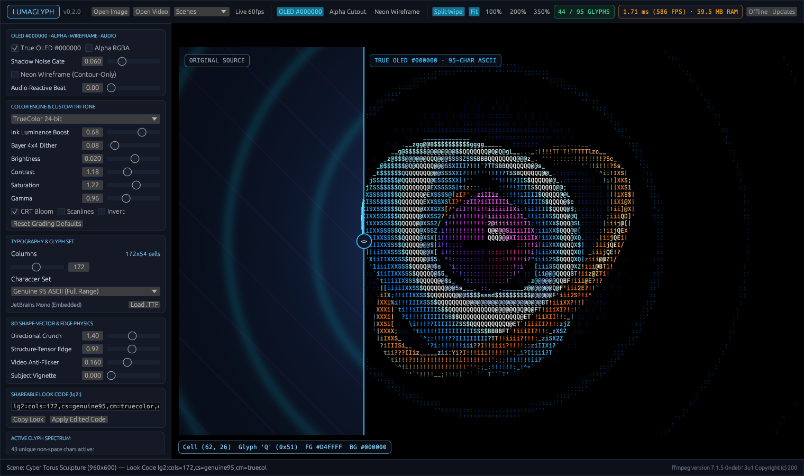
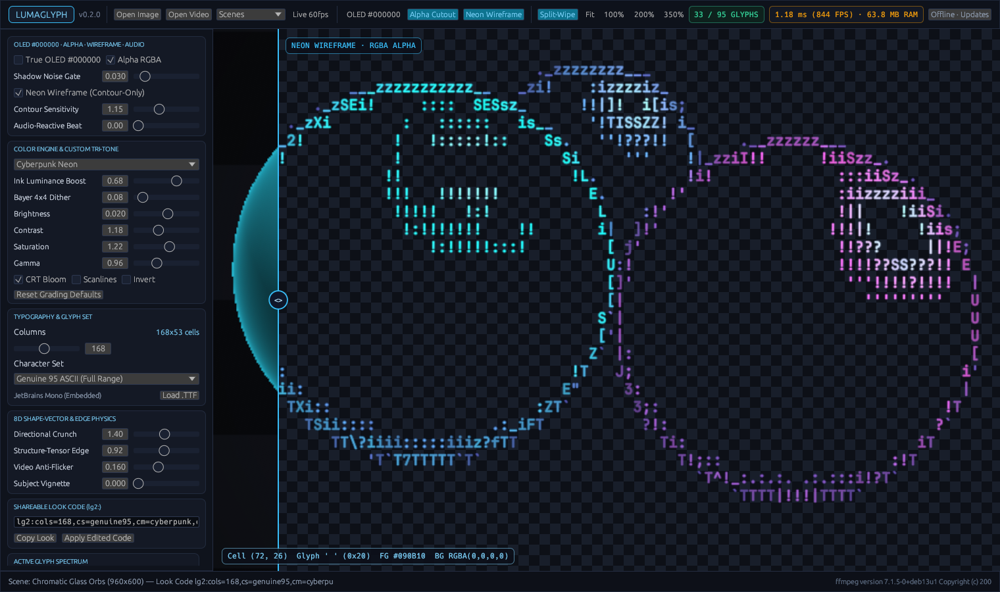
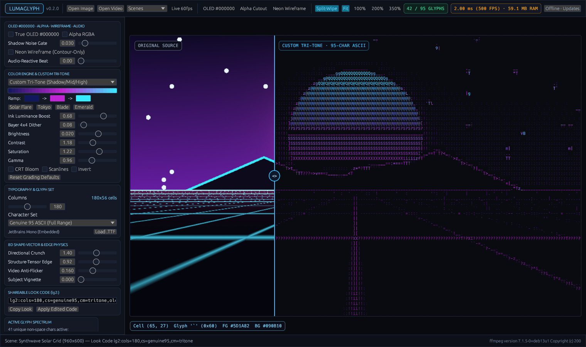
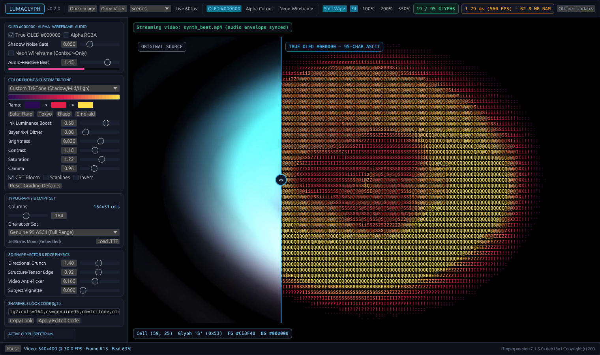

# LumaGlyph

[](https://github.com/goldggs/lumaglyph/actions/workflows/ci.yml)
[](https://github.com/goldggs/lumaglyph/releases)
[](LICENSE)

**Blazing-fast, ultra-low-memory genuine 95-character color ASCII art & video studio in pure Rust.**

Unlike basic 10-character brightness ramps (`@%#*+=-:. `), **LumaGlyph** treats every printable 7-bit ASCII glyph (`0x20..=0x7E`) as 2D geometry. Each font is dynamically calibrated into 32-byte-aligned **8D shape + structure-tensor orientation vectors**, locking `/ \ | _ ( ) [ ] < > ^ ~ , ' ; ! ? $ & % W M # @` directly onto curves, diagonals, silhouettes, and tonal gradients at **500+ FPS** (`< 2 ms/frame`) and **`~7–9 MB` CLI RSS**.





---

## New in `v0.2.0`

- **True OLED `#000000` Pitch-Black Mode + Shadow Noise Gate:**
  - `--oled-black` switches both the ASCII canvas and studio surround to exact `#000000` (`[0, 0, 0]`) so physical OLED subpixels shut 100% off with zero dark-gray halo.
  - `--black-gate <0.00..0.35>` cleanly gates dark camera/compression noise to `' '` + `#000000` so night skies and dark shadows never shimmer with stray `.` or `,` grain.
- **Transparent Alpha Exports (`RGBA [0,0,0,0]`) + Neon Wireframe Overlay Mode:**
  - `--transparent` renders true alpha cutouts across **PNG**, **SVG**, **HTML**, **GIF**, **VP9 Alpha `.webm` (`yuva420p`)**, and **RGBA `.mov`** so you can drop glowing ASCII directly on top of footage in Premiere, DaVinci Resolve, After Effects, OBS, or the web.
  - `--wireframe` strips flat interior fills and illuminates only razor-sharp directional contour strokes.
- **Audio-Reactive ASCII Video (`--audio-reactive`):**
  - Taps a zero-dependency mono 8 kHz `s16le` RMS + transient onset envelope from `ffmpeg` in tiny 1-frame chunks (keeping flat `~8 MB` RAM) to pulse luminance compensation, structure-tensor edge lock, and CRT phosphor bloom in sync with kicks and basslines.
- **Custom Tri-Tone Color Ramp Picker (`--tritone`):**
  - Interactive **Shadow &rarr; Midtone &rarr; Highlight** color pickers in the Studio + instant presets (`Solar Flare`, `Tokyo`, `Blade`, `Emerald`) or any hex triplet (`--tritone 120428-00E5FF-FFE680`).
- **One-Line Shareable `lg2:` Look Codes (`--look`):**
  - Copy/paste your entire visual recipe (`Copy Look` / `Apply Edited Code` in Studio, or `--look "lg2:..."` in CLI) as a compact, human-readable one-liner.





---

## Core Highlights

- **Genuine 95-Character Shape-Vector Matching:** 6 staggered spatial sub-cells + 2D structure-tensor orientation (`Jxx - Jyy`, `2·Jxy`) with external-neighbor directional contrast crunching.
- **9 Color Modes:** **TrueColor 24-bit** (with ink-coverage luminance compensation), **Dual-Color (FG + Ambient BG)**, **Custom Tri-Tone**, **CRT Amber & P1 Green Phosphor**, **Cyberpunk Neon**, **ANSI-16**, **xterm-256**, and **Monochrome Ivory** + ordered **Bayer 4×4 dithering**.
- **Smooth Video-to-ASCII with Flat RAM (~4–9 MB):** Bounded `ffmpeg` streaming pipes handle 4K or hour-long videos without buffering frames in memory while preserving audio tracks (`AAC`/`Opus`) and applying **Temporal Anti-Flicker** hysteresis.
- **100% Native Offline by Default:** Zero telemetry and zero startup sockets. Connects to `api.github.com/repos/goldggs/lumaglyph/releases/latest` only when you click **Check GitHub Releases Now** or explicitly opt in.
- **Path-Sanitized GitHub Actions Releases:** Built cleanly inside GitHub Actions runners across **Linux (`x86_64`)**, **macOS (`arm64` & `x86_64`)**, and **Windows (`x86_64`)** with `--remap-path-prefix`, `/DEBUG:NONE`, symbol stripping, and an automated CI binary byte-audit.

---

## Quick Start

Download prebuilt binaries for **Linux**, **macOS**, and **Windows** from [**GitHub Releases**](https://github.com/goldggs/lumaglyph/releases).

### Launch Native GPU Studio
```bash
lumaglyph
# Open an image or video directly in the studio:
lumaglyph photo.png
lumaglyph clip.mp4
```

### Headless CLI — Image to Genuine ASCII
```bash
# True OLED #000000 pitch-black PNG with Shadow Noise Gate + CRT Bloom
lumaglyph image input.jpg -o oled_art.png --cols 172 --oled-black --black-gate 0.06 --bloom

# Transparent RGBA Neon Wireframe overlay PNG + Custom Tri-Tone ramp
lumaglyph image input.jpg -o overlay.png --cols 168 --transparent --wireframe --tritone tokyo

# Apply a shareable lg2: Look Code directly
lumaglyph image input.jpg -o styled.png --look "lg2:cols=180,cs=genuine95,cm=tritone,oled=1,gate=0.050,bl=1,tri=2A0A52-E11D48-FDE047"
```

### Headless CLI — Flat-RAM Video to ASCII Video
> Requires `ffmpeg` / `ffprobe` on `PATH` (or placed next to the `lumaglyph` executable).

```bash
# Audio-Reactive + True OLED #000000 H.264 MP4 (audio preserved, flat ~8 MB RAM)
lumaglyph video input.mp4 -o reactive_oled.mp4 --cols 164 --oled-black --audio-reactive 1.30 --tritone solar --bloom

# Transparent Alpha VP9 .webm or QuickTime RGBA .mov wireframe overlay for Premiere / Resolve / OBS
lumaglyph video input.mp4 -o alpha_overlay.webm --cols 152 --transparent --wireframe --tritone tokyo
lumaglyph video input.mp4 -o alpha_overlay.mov  --cols 152 --transparent --wireframe
```

### Benchmark Throughput & Memory Footprint
```bash
lumaglyph bench --cols 180 --iters 200
```

---

## Building from Source

```bash
cargo build --release --locked
```

On Debian/Ubuntu Linux, install windowing/GL headers before building the GUI:
```bash
sudo apt-get install -y \
  libxcb-render0-dev libxcb-shape0-dev libxcb-xfixes0-dev \
  libxkbcommon-dev libxkbcommon-x11-dev libwayland-dev \
  libxcursor-dev libxi-dev libxinerama-dev libxrandr-dev \
  libgl1-mesa-dev libegl1-mesa-dev
```

---

## License

Released under the [MIT License](LICENSE). Includes embedded [JetBrains Mono](assets/fonts/OFL-JetBrainsMono.txt) under the SIL Open Font License 1.1.
