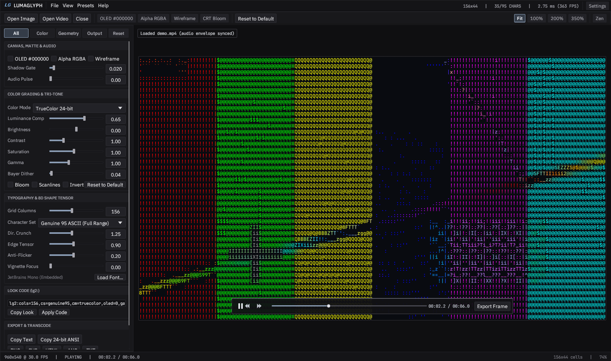

# LumaGlyph User Guide

Everything in the app, one page at a time. No prior knowledge assumed.

- [1. The window at a glance](#1-the-window-at-a-glance)
- [2. Opening files](#2-opening-files)
- [3. The canvas](#3-the-canvas)
- [4. The Inspector](#4-the-inspector)
- [5. Video playback and frame export](#5-video-playback-and-frame-export)
- [6. Settings, tab by tab](#6-settings-tab-by-tab)
- [7. Exporting](#7-exporting)
- [8. Look Codes](#8-look-codes)
- [9. Updates and privacy](#9-updates-and-privacy)
- [10. Keyboard shortcuts](#10-keyboard-shortcuts)

---

## 1. The window at a glance

LumaGlyph opens **empty** on purpose: a slim menu bar, a calm dark canvas, a few recessed key
hints, and a status strip at the bottom. Nothing is loaded, nothing is rendered, nothing is
downloaded.

As soon as you open media, the **Command Strip** (a toolbar) and the **Inspector** (grading panel)
appear. You can hide the Inspector again with `Ctrl + B`, and hide all the chrome with `Tab`
(Zen mode).

Elements, top to bottom:

| Area | What it is |
| :--- | :--- |
| Menu bar | File, View, Presets, Help. Everything is reachable from here. |
| Command Strip | Quick toggles for OLED black, wireframe, and common actions. Hidden in an empty window. |
| Inspector (left) | The grading controls. Hidden until you open media or press `Ctrl + B`. |
| Canvas (center) | Your image or video as ASCII art. |
| Status strip (bottom) | File info, timeline position, cell counts, memory use, optional live FPS. |

---

## 2. Opening files

- **Open Image** - `Ctrl + O`. Supports PNG, JPEG, WebP, GIF, BMP.
- **Open Video** - `Ctrl + Shift + O`. Supports MP4, MKV, MOV, WebM, AVI, M4V.
- **Load Font** - `File > Load Font (.ttf/.otf)`. Uses your own font for the ASCII cells.
- **Drag and drop** works for all three.

Video playback needs `ffmpeg` on your system. If LumaGlyph cannot find it, the app still works for
images, and `Settings > Export & Video` lets you point at a custom ffmpeg folder.

---

## 3. The canvas

| Action | How |
| :--- | :--- |
| Zoom | Mouse wheel, or keys `1` (100%), `2` (200%), `3` (350% loupe) |
| Zoom to fit | Key `0` |
| Pan | Drag with the mouse (when zoomed in) |
| Cell readout | Hover the canvas - shows character, foreground color, background |
| Zen mode (hide all panels) | `Tab` |
| OLED true black | `B` |
| Neon wireframe (edges only) | `N` |
| More / fewer columns | `[` and `]` |

The canvas draws only when something changes, so a still image costs essentially nothing while you
look at it.

---

## 4. The Inspector

The Inspector is a single scrolling column of controls, grouped by purpose. Every fader has a
default you can return to by double-clicking its label.

**Tone**

- **Brightness** - lifts or drops the whole image.
- **Contrast** - expands or compresses the tonal range.
- **Saturation** - 0 is monochrome, 1 is untouched, above 1 is punchier.
- **Gamma** - bends midtones without touching black or white.

**Structure**

- **Edge Weight** - how strongly strong edges attract matching characters such as `/`, `|`, `_`.
- **Directional Crunch** - how aggressively the engine prefers a character whose shape lines up with
  the local edge direction.
- **Dither** - small noise that keeps flat gradients from banding.

**Characters**

- **Columns** - how many characters wide the art is. Higher is more detailed but slower.
- **Character Set** - Genuine 95 (all printable ASCII), plus curated subsets.
- **Glyph Size** - the pixel height each character cell is rasterized at (`16`, `20`, `28` px).
- **Load custom font** - use any `.ttf` or `.otf` you own.

**Color**

- **Color Mode** - TrueColor, ANSI 256, ANSI 16, monochrome, phosphor amber, and more.
- **OLED #000000** - forces pure black backgrounds for OLED displays.
- **Transparent Background** - exports real RGBA transparency.
- **Neon Wireframe** - keeps only contour characters.

**Effects**

- **CRT Bloom**, **Scanlines**, **Invert**, **Audio Reactive** - stylistic finishing options.

**Look Code**

A single text field that encodes every setting above into one short `lg2:` line. See
[section 8](#8-look-codes).

---

## 5. Video playback and frame export

Video controls are drawn **on the video itself**, at the bottom of the picture:

| Control | What it does |
| :--- | :--- |
| Play / pause button | Starts or pauses playback. `Space` does the same from the keyboard. |
| Back / forward arrows | Jump 5 seconds earlier or later. |
| Timeline bar | Shows your position in the clip. Click or drag anywhere on it to scrub. |
| Timecode | Current position and total length, e.g. `00:12.4 / 01:30.0`. |
| Export Frame | Menu with three choices, described below. |

**Export Frame** offers:

1. **ASCII Frame (PNG)** - the ASCII art exactly as it looks right now, at your export scale.
2. **Source Video Frame (PNG)** - the untouched original frame at full video resolution. Useful for
   thumbnails, posters, or comparing the two.
3. **Copy ASCII Frame as Text** - copies the current frame's colorful text to the clipboard.

Frame export always targets the frame on the timeline, so you can pause anywhere - or scrub while
paused - and grab exactly that frame.

Scrubbing is instant even in long files because LumaGlyph re-seeks the decoder instead of decoding
from the beginning.

---

## 6. Settings, tab by tab

Open with `Ctrl + ,`. The window has a navigation rail on the left and seven panes.

### Appearance

- **Workstation Theme** - Graphite Pro (default), OLED Reference, Carbon Tungsten, Nordic Slate,
  Daylight Paper.
- **Indicator Accent** - the accent color used for active states.
- **Interface Density** - Standard or Compact.
- **Corner Geometry** - Precision (2 px) or softer rounding.
- **Alpha Checkerboard** - how visible the transparency checker is.
- **Show hover cell readout**, **Draw canvas hairline**, **Show status strip** - chrome toggles.

### Engine & Defaults

The starting state for every newly opened file: default columns, default character set, default
color mode, whether OLED black starts on, glyph raster resolution, active font, and the two reset
actions (**Reset ASCII Parameters** and **Restore All Settings**).

### Rendering & Quality

- **Frame Rate Cap** - Uncapped, 15, 24, 30, 60 (default) or 144 FPS. This caps how often the
  workstation redraws; video playback timing is unaffected.
- **Texture Sampling** - Auto (sharp when zoomed), Nearest, or Bilinear.
- **Canvas Raster Supersampling** - 1x standard, or 2x supersampled for crisper glyph edges when you
  zoom in (costs more GPU memory).
- **VSync** - waits for the display's vertical blank to avoid tearing. Applied at next launch.
- **Smoothed zoom & scrolling** - animated zoom steps instead of instant jumps.
- **Show live measured FPS** - adds an actual render-rate readout to the status strip.
- **Multisample Anti-Aliasing** - Off, 2x, 4x (default), 8x. Applied at next launch.

### Optimisations

- **Go idle when the window loses focus** - while you work in another window, LumaGlyph stops
  redrawing entirely, so it uses no CPU.
- **Pause video decoding while unfocused** - also parks the video decoder thread.
- **Stay fully idle while minimized**.
- **Release scratch buffers after 10 seconds of idle** - hands memory back to the operating system.
- **ASCII Engine Worker Threads** - `0` means automatic. Set a number to limit CPU use on laptops.
- **Skip re-rendering identical consecutive video frames** - avoids redundant work on static shots.
- **Live Preview Decode Height Cap** - 480p, 640p (default), 854p, 1080p. Lower is faster and cooler;
  exports are always computed at full quality regardless of this setting.
- **Analyze audio beat envelope** - needed for audio-reactive grading; turning it off saves a
  pre-pass over the file.

### Export & Video

PNG export scale (1x, 2x HiDPI, 3x print), video quality (CRF), and a custom `ffmpeg` folder.

### Shortcuts

The complete key map, in the app.

### About & Build

Version, git revision, target, compiler, GPU renderer, ffmpeg version, memory use, license, plus:

- **Copy Build Info** - full technical dump for bug reports.
- **Documentation & Support** buttons - Quick Start, Download & Install, User Guide,
  Troubleshooting, Latest Downloads.
- **Check GitHub Releases** / **Update & Relaunch** - see section 9.

---

## 7. Exporting

| Format | Best for |
| :--- | :--- |
| **PNG** | Sharing the art, printing, wallpapers. Choose 1x/2x/3x in Settings. |
| **TXT** | The raw characters, when you want to paste into a terminal or editor. |
| **ANSI** | Colorful terminal output; also reads well in Discord with a code block. |
| **SVG** | Vector version that stays sharp at any size. |
| **HTML** | A self-contained page that opens in any browser. |
| **Video** | Re-encode an entire video as ASCII art frames. |
| **Frame (PNG)** | A single still from a video - ASCII or original. |

---

## 8. Look Codes

A Look Code is a one-line `lg2:` string that stores every grading parameter. Use it to:

- save a look you like in a notes file,
- send a look to a friend,
- reproduce a look later without re-dragging sliders.

Copy with `Ctrl + Shift + C`, paste into the Look Code field in the Inspector to apply.

---

## 9. Updates and privacy

LumaGlyph is **offline by default**. It makes no network requests unless you explicitly ask:

- **Help > Check GitHub Releases...** checks for a newer version.
- **Settings > About & Build > Check Releases** does the same.
- **Update & Relaunch** downloads, verifies with SHA-256, replaces the installed binary in place, and
  restarts into the new version.

Every download is verified before it can touch your system: the exact release tag, the exact file
for your OS and CPU, and a constant-time SHA-256 comparison against the release's checksum file. If
anything does not match, nothing is installed.

There is no telemetry, no analytics, and no crash reporting.

---

## 10. Keyboard shortcuts

| Keys | Action |
| :--- | :--- |
| `Ctrl + O` | Open image |
| `Ctrl + Shift + O` | Open video |
| `Ctrl + W` | Close media |
| `Ctrl + S` | Export PNG |
| `Ctrl + Shift + C` | Copy Look Code |
| `Ctrl + ,` | Open / close Settings |
| `Ctrl + B` | Toggle Inspector |
| `Ctrl + Shift + R` | Reset everything to default |
| `F1` | Open documentation |
| `Tab` | Zen mode |
| `Space` | Play / pause video |
| `Left` / `Right` | Seek 5 seconds (video) |
| `B` | OLED black |
| `N` | Neon wireframe |
| `[` / `]` | Fewer / more columns |
| `0` / `1` / `2` / `3` | Zoom fit / 100% / 200% / 350% |
| `Mouse wheel` | Zoom |
| `Double-click a fader label` | Reset that fader |
